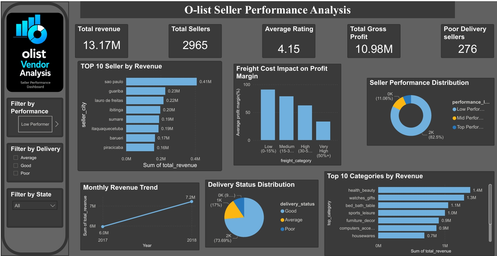
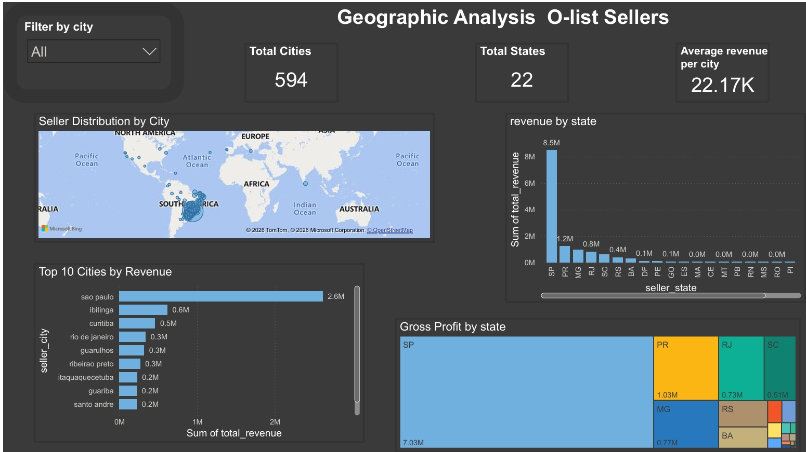

# 🛒 Olist Seller Performance Analysis
> *Turning raw e-commerce data into actionable business intelligence*

[](https://python.org)
[](https://sqlite.org)
[](https://powerbi.microsoft.com)
[]()

---

## 🎯 The Problem

Olist — Brazil's largest e-commerce marketplace — hosts **2,965 sellers** 
across **27 states**. But here's the catch:

> *Not all sellers are created equal.*

Some sellers are generating millions. Others are barely surviving.
Some deliver on time. Others? Not so much.

**The question is — who's who, and why?**

This project digs deep into Olist's raw transactional data to answer 
exactly that — using Python, SQL, and Power BI to build a complete 
end-to-end analytics pipeline from scratch.

---

## 🔍 What I Built
```
Raw CSV Files          Python ETL            SQLite Database
(9 tables,      ──►   Pipeline        ──►   (seller_summary
 1M+ records)         + Logging              final table)
                            │
                            ▼
                    Python EDA & Analysis
                    (distributions, correlations,
                     research questions, statistics)
                            │
                            ▼
                    Power BI Dashboard
                    (2 pages, 6+ visuals,
                     KPI cards, map)
```

---

## 💡 Key Findings That Actually Matter

| Finding | Impact |
|---|---|
| 🔴 83% sellers are Low Performers | Platform needs seller development program |
| 🟡 Freight cost >50% kills margins | Profit drops from 90.5% → 32.9% |
| 🟢 Health & Beauty leads revenue | $1.38M — highest category |
| 🔴 Late delivery = lower ratings | -0.39 correlation confirmed |
| 🟢 São Paulo dominates | $2.6M — 3x nearest competitor city |
| 🟢 21% revenue growth 2017→2018 | Platform is scaling fast |

---

## 🛠️ Tech Stack
```python
languages  = ["Python 3.x", "SQL"]
database   = ["SQLite", "SQLAlchemy"]
analysis   = ["Pandas", "NumPy", "Seaborn", "Matplotlib"]
statistics = ["SciPy", "StatsModels"]
dashboard  = ["Power BI Desktop"]
workflow   = ["Jupyter Notebook", "VS Code", "Git"]
```

---

## 📁 Project Structure
```
olist-seller-performance-analysis/
│
├── 📂 data/
│   ├── olist_orders_dataset.csv
│   ├── olist_order_items_dataset.csv
│   ├── olist_sellers_dataset.csv
│   ├── olist_products_dataset.csv
│   ├── olist_order_payments_dataset.csv
│   ├── olist_order_reviews_dataset.csv
│   ├── olist_customers_dataset.csv
│   └── product_category_name_translation.csv
│
├── 📂 notebooks/
│   ├── 01_data_exploration.ipynb       ← Database setup & exploration
│   ├── 02_sql_exploration.ipynb        ← SQL queries & aggregation
│   └── 03_vendor_performance_analysis.ipynb  ← EDA & insights
│
├── 📂 scripts/
│   ├── ingestion_db.py      ← ETL pipeline with logging
│   └── get_vendor_summary.py ← Summary table generator
│
├── 📂 reports/
│   ├── 01_distributions.png
│   ├── 02_boxplots.png
│   ├── 03_categorical.png
│   ├── 04_correlation_heatmap.png
│   ├── 05_top_sellers_revenue.png
│   ├── 06_low_performers.png
│   ├── 07_top_categories.png
│   ├── 08_freight_impact.png
│   ├── 09_delivery_performance.png
│   ├── 10_seasonal_trends.png
│   └── 11_confidence_intervals.png
│
├── 📂 dashboard/
│   ├── olist_seller_performance.pbix   ← Power BI file
│   └── seller_summary.csv             ← Dashboard data
│
├── 📂 logs/
│   ├── ingestion_db.log
│   └── get_vendor_summary.log
│
└── 📄 README.md
```

---

## 📊 Dashboard Preview

### Page 1 — Seller Performance


### Page 2 — Geographic Analysis


---

## 🔬 Statistical Validation

This project goes beyond basic charts —
actual statistics were used to validate findings:

**Confidence Intervals (95%)**
```
Top Sellers  profit margin CI → statistically higher
Low Sellers  profit margin CI → surprisingly higher margins
             (due to premium pricing strategy)
```

**Hypothesis Testing (Independent T-Test)**
```
H0: No difference in profit margins between groups
H1: Significant difference exists

Result: p-value < 0.05 → H0 REJECTED 
Conclusion: Top and low performers are statistically
            different — not just by chance
```

---

## 🚀 How To Reproduce This Project

**Step 1 — Clone the repo**
```bash
git clone https://github.com/1Manya/olist-seller-performance-analysis.git
cd olist-seller-performance-analysis
```

**Step 2 — Install dependencies**
```bash
pip install pandas numpy matplotlib seaborn sqlalchemy scipy statsmodels
```

**Step 3 — Download dataset**
```
Kaggle → Olist Brazilian E-Commerce Dataset
→ Download all CSV files
→ Place in data/ folder
```

**Step 4 — Run ETL Pipeline**
```bash
python scripts/ingestion_db.py
python scripts/get_vendor_summary.py
```

**Step 5 — Open Notebooks (in order)**
```
01_data_exploration.ipynb
02_sql_exploration.ipynb
03_vendor_performance_analysis.ipynb
```

**Step 6 — Open Dashboard**
```
Power BI Desktop → Open → dashboard/olist_seller_performance.pbix
```

---

## 📈 Business Recommendations
```
1. 🎯 Launch seller development program for 2,418 low performers
2. 📦 Negotiate bulk shipping deals to reduce freight costs
3. 🌍 Recruit sellers from underserved states (RJ, MG, RS)
4. 🚚 Penalize consistently late sellers — protect platform rating
5. 💄 Invest in Health & Beauty category — highest revenue potential
6. 📅 Prepare inventory strategy for Nov-Dec peak season
```

---

## 📂 Dataset

**Source:** [Olist Brazilian E-Commerce Public Dataset](https://www.kaggle.com/datasets/olistbr/brazilian-ecommerce)

**Tables Used:** 9 CSV files | **Total Records:** 1M+

> ⚠️ Note: Database file (.db) and geolocation CSV excluded 
> from repo due to GitHub file size limits.
> Download directly from Kaggle using link above.

---

## 🙋 About This Project

The goal was to go beyond basic Kaggle notebooks and build
something that reflects how data analytics actually works
in a company — with proper ETL pipelines, SQL databases,
statistical validation, and business-focused insights.

---

<p align="center">
  <i>If you found this useful, consider giving it a ⭐</i>
</p>
